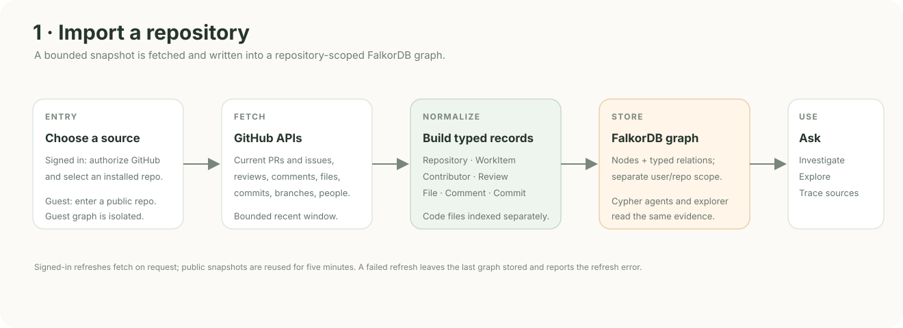
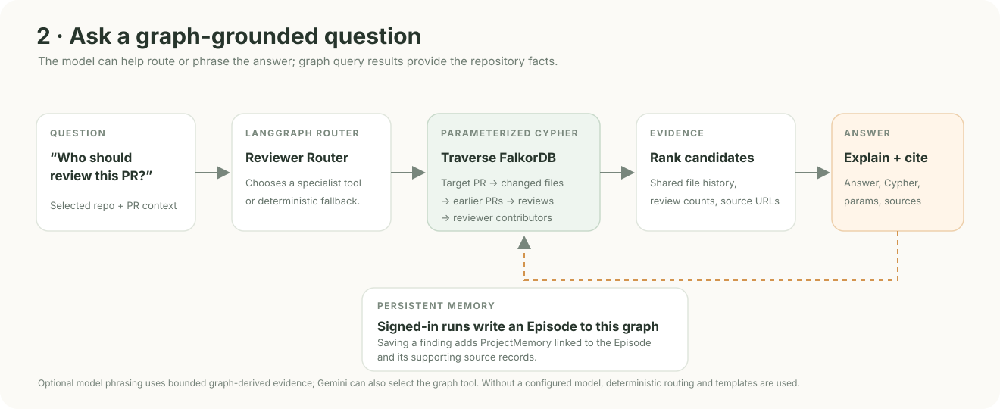
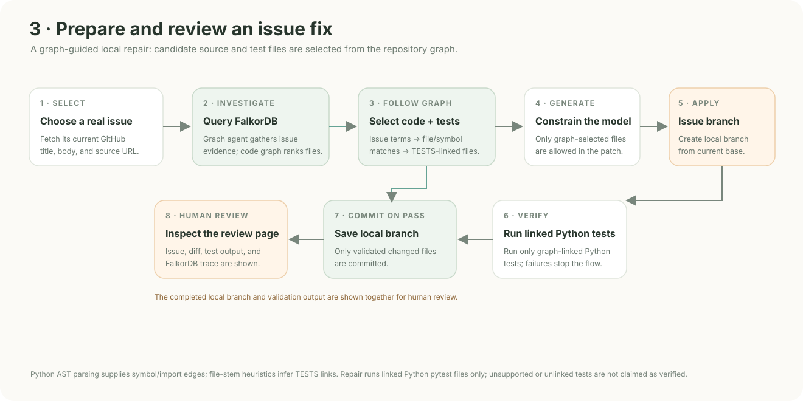
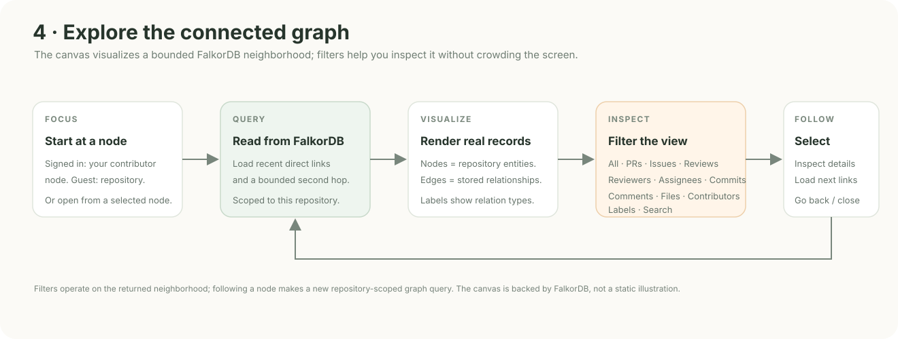
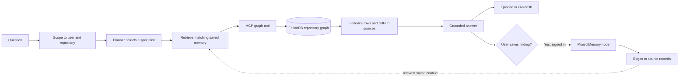
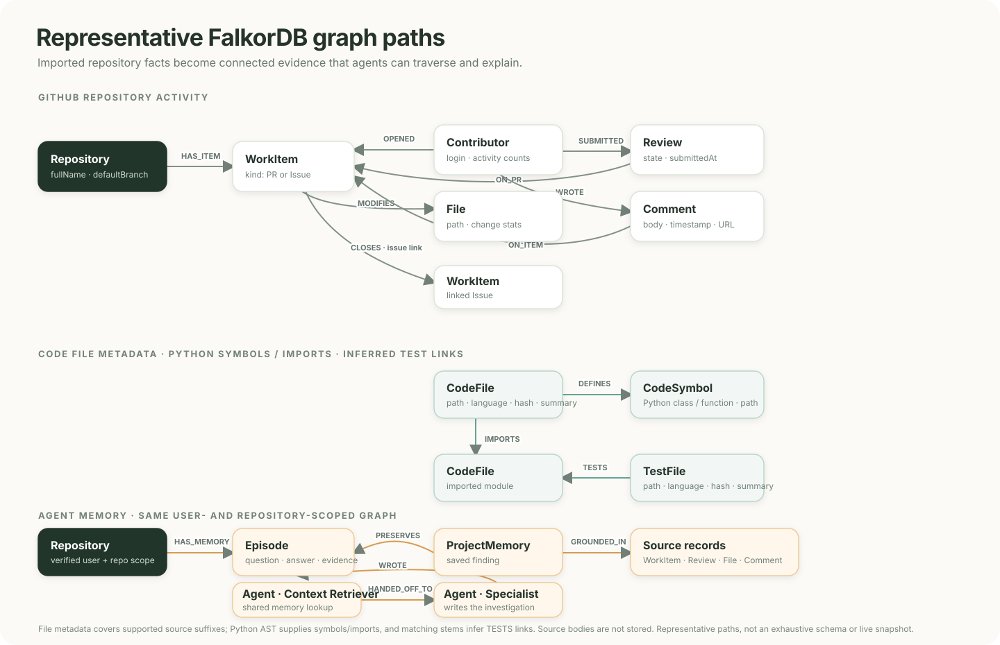

<p align="center">
  
</p>

<h1 align="center">Engram</h1>

<p align="center"><strong>Repository knowledge you can trace, save, and use again.</strong></p>

Engram turns the activity around a GitHub repository into a FalkorDB knowledge graph. Its agents follow connections between contributors, pull requests, reviews, files, commits, issues, and discussions to answer questions with evidence. Signed-in users can save source-backed findings as project memory and retrieve relevant notes in later investigations.

## The problem

The reason behind a code change is rarely in one place. A pull request may touch a file that was reviewed in earlier work, discussed in an issue, and understood by a contributor who has since moved on. Finding that context by browsing GitHub record by record is slow, especially for someone new to the repository.

Engram connects those records as a graph and lets an agent investigate the paths between them. The product is repository-agnostic: a signed-in user selects a repository from their GitHub installation, while visitors can import and explore any public repository without signing in.

## A short product walkthrough

1. **Choose a repository.** Connect GitHub, or enter a public `owner/repo` in the guest explorer.
2. **Build its graph.** Engram imports a bounded, recent activity window and writes typed repository records and relationships to FalkorDB.
3. **Ask an investigation question.** For example, “Who should review PR #442?” The Reviewer Router follows the PR's changed files to earlier PRs and reviews, then ranks contributors by relevant review history.
4. **Inspect the evidence.** Read the source-linked answer, inspect the Cypher query and parameters, and explore the connected graph neighborhood.
5. **Carry a finding forward.** A signed-in user can save an investigation to project memory. Engram links that memory to its source records and can surface it during later, related investigations.

Public guest graphs are isolated by repository. Guest questions are read-only and are not saved as personal memory.

## Product flows at a glance

### Import a repository



### Ask a graph-grounded question



### Investigate and prepare an issue fix



### Explore and follow graph connections



## Reviewer intelligence: find a reviewer from graph evidence

Start with a public repository and one of its pull requests. Ask, “Who should review this change?” The Reviewer Router reads the pull request’s changed files, follows those files to earlier pull requests, then follows submitted reviews to the contributors who reviewed that work. It ranks candidates from those observed connections and returns the supporting repository records with GitHub links.

The graph explorer makes that reasoning inspectable. **All** shows the connected neighborhood; PRs, Issues, Reviews, Reviewers, Assignees, Commits, Comments, Files, Contributors, and Labels narrow it to matching graph records or relationships. Select a node to inspect its properties and direct links, then follow it to load a new neighborhood. The same paths can be inspected through the Cypher query and parameters shown with an answer.

To see why the graph matters, follow the recommendation in the explorer and filter to **Reviews** or **Reviewers**. The result comes from a path through changed files, prior pull requests, and review activity, rather than a keyword match alone.

## Issue repair: from issue report to a reviewed local change

1. In a signed-in repository, open **Code graph**, refresh the current issue list, and import the current default-branch source snapshot.
2. Select an issue and choose **Fix selected issue**. Engram fetches its current GitHub details and asks the FastAPI graph investigator for related evidence from the selected user's FalkorDB graph.
3. The repair agent compares issue terms and graph evidence with indexed file and symbol properties, then follows stored `TESTS` relationships to select regression-test files. It requires graph-selected source and test files before proceeding.
4. The configured model receives the issue, graph evidence, and a bounded set of selected source snippets. Engram accepts changes only to the selected file paths and requires at least one selected test file to change.
5. Engram fetches the latest base branch, creates an `engram/issue-*` branch in the configured checkout, applies the patch, and runs targeted checks. Existing checkout changes are preserved in a recoverable stash. A local commit is made only if the checks pass.

The review page presents the issue, model summary, branch and base commit, changed files, diff, test output, and a separate FalkorDB trace. Its approval control is a review affordance in the current local flow.

Configure `ENGRAM_REPAIR_ROOT` and, if you want Engram to use an existing checkout, map `owner/repo` to its path in `ENGRAM_REPAIR_CHECKOUTS` as described below. Otherwise Engram creates a local clone under the repair root. After a repair, `git branch --show-current` in that checkout shows the active issue branch. If Engram stashed pre-existing changes, inspect `git stash list`; the stash is retained for explicit recovery and is not dropped automatically. Review the generated patch and test result critically; a model-proposed fix is not proof of correctness.

See [the 3–4 minute demo script](docs/DEMO_SCRIPT.md) for the click path and narration.

## How the agent works



The LangGraph workflow contains a planner, a saved-memory retrieval step, an MCP tool call, and a grounded answer step. Gemini can select a read-only tool and phrase the graph-derived draft when configured. Deterministic routing and answer templates remain available without a model key. The model does not supply the underlying repository facts.

The five specialist tools are:

| Investigator | FalkorDB tool | Typical question |
|---|---|---|
| Reviewer Router | `reviewer_candidates` | Who has reviewed work on the files in this PR? |
| Expertise Finder | `expertise_lookup` | Who has relevant review history for this topic or path? |
| Decision Trace | `decision_trace` | Which discussions may explain this change? |
| Contributor Activity | `contributor_activity` | Who has recently contributed commits in the indexed window? |
| Project Guide | `repository_search` | Which PRs or issues match this record, topic, or contributor? |

Each investigation is stored as an `Episode` in the signed-in user's repository graph. Saving an answer creates a `ProjectMemory` node connected to that episode and to matching GitHub source nodes with `GROUNDED_IN` edges. Memory is scoped to the authenticated user and selected repository; it is never shared with guest graphs or another user's graph.

## Why FalkorDB is part of the reasoning

Engram needs to follow relationships, not just retrieve isolated text. A reviewer recommendation is based on paths such as:

```text
Pull request ──MODIFIES──> File
File <──MODIFIES── Prior pull request
Prior pull request <──ON_PR── Review <──SUBMITTED── Contributor
```

Parameterized Cypher traversals find the connected records and calculate evidence such as shared files and related reviews. The answer exposes the query, its parameters, source links, and a bounded graph neighborhood so a user can check the result. FalkorDB stores both imported GitHub entities and Engram's episode and project-memory nodes in the same graph.

### What Engram stores and traverses

The diagram below documents the graph schema written by the GitHub importer, source-code indexer, and agent workflow. A reviewer investigation follows connected PR, file, review, and contributor records; issue repair uses the indexed `CodeFile`, `CodeSymbol`, and `TestFile` neighborhood. These are real FalkorDB labels and relationships from the implementation. Code-structure links share the `CODE_RELATION` relationship type and carry their specific edge kind in its `kind` property.



Code graph nodes store metadata such as paths, hashes, summaries, and parsed symbols rather than source bodies. During repair, Engram reads source text from the selected base only for candidate files chosen with FalkorDB evidence.

*Schema view, not a live database screenshot. The graph explorer and the Cypher shown with an answer expose the records and paths imported for the selected repository.*

## Capability map

| User-visible capability | Implementation |
|---|---|
| Connect a GitHub account and select a repository | GitHub App user authorization, installation access, Next.js session boundary |
| Explore a public repository without OAuth | Public GitHub REST import, reserved guest graph, read-only API routes |
| Ask a repository question | Next.js API route, FastAPI agent core, LangGraph workflow |
| Discover investigators and call tools | FastMCP catalog and parameterized, read-only FalkorDB tools |
| Review graph paths and source records | Cypher trace, source links, neighborhood explorer, node detail |
| Filter and follow graph connections | FalkorDB-backed All, PR, issue, review, reviewer, assignee, commit, comment, file, contributor, and label views |
| Remember an investigation across sessions | `Episode` nodes, user-saved `ProjectMemory` nodes, `HAS_MEMORY`, `PRESERVES`, and `GROUNDED_IN` relationships |
| Import source structure for issue repair | Current GitHub default-branch snapshot, parsed into `CodeFile`, `CodeSymbol`, and `TestFile` nodes with `IMPORTS`, `DEFINES`, and graph-linked `TESTS` edges in FalkorDB; repair reads source from the selected base only for graph-selected files |
| Prepare a local issue repair | Graph-linked investigator, bounded model patch generation, active issue branch in the configured checkout, focused checks, local commit, diff review, and a separate graph trace page |
| Use natural phrasing when configured | Optional provider tool selection and constrained graph-grounded synthesis with deterministic fallback |

## Architecture

| Layer | Technology | Responsibility |
|---|---|---|
| Web app | Next.js 15 App Router, React 18, TypeScript | Landing/setup flows, repository workspaces, graph explorer, chat and API gateway |
| Authentication boundary | GitHub App OAuth, `jose`, Node.js crypto | Validates OAuth state/PKCE, encrypts the session, scopes repository access |
| Agent core | Python 3.12, FastAPI, LangGraph | Plans each investigation, retrieves saved context, calls graph tools, grounds answers |
| Tool boundary | FastMCP | Exposes the repository investigators through MCP discovery and tool calls |
| Graph store | FalkorDB | Stores typed repository entities, their relationships, episodes, and saved project memory |
| Source data | GitHub REST API | Supplies current public or installation-authorized repository activity |
| Optional model | Gemini, OpenAI, Anthropic, Groq, OpenRouter, Together, DeepSeek, or Ollama | Optional tool selection, answer phrasing, and issue patch proposals; graph results remain the source of repository facts |
| Local/deployment services | Docker Compose, Caddy | Runs the graph and Python core locally; production Compose adds HTTPS reverse proxying |

The browser never connects directly to FalkorDB or the Python core. Next.js validates the user session and selected repository, then calls FastAPI over an internal key-protected service boundary. The core derives the graph name from the verified GitHub user ID and repository.

## Data model

| Graph node | Stored context |
|---|---|
| `Repository` | Full name, URL, default branch, visibility, import time and newest indexed activity |
| `Contributor` | GitHub login and links to observed work, reviews, comments, and commits |
| `WorkItem` | Pull request or issue, state, author, timestamps, labels, assignees, and source URL |
| `Review` / `Comment` | Reviewer or author, state or text, timestamp, and source URL |
| `File` | Path and its links to pull requests and commits |
| `Commit` / `RepositoryBranch` | SHA, message, author, date, branch, and source URL |
| `RepositoryLabel` | Label name attached to indexed pull requests or issues |
| `CodeFile` / `TestFile` | Repository-relative path, language, file size, hash, summary, and test/source classification |
| `CodeSymbol` | A parsed Python class or function name and its defining file |
| `CodebaseSnapshot` | Imported source revision, branch, timestamp, and node/relationship counts |
| `Agent` | Specialist agent that produced an investigation episode |
| `Episode` | Question, graph-grounded answer, investigator, evidence count, and source metadata |
| `ProjectMemory` | User-saved investigation, timestamp, and graph links to the episode and source records |

Relationships include `HAS_ITEM`, `OPENED`, `ASSIGNED`, `REVIEW_REQUESTED`, `MODIFIES`, `SUBMITTED`, `ON_PR`, `WROTE`, `ON_ITEM`, `HAS_COMMIT`, `AUTHORED`, `HAS_BRANCH`, `ON_BRANCH`, `CLOSES`, and `HAS_LABEL`. Agent memory uses `HAS_MEMORY`, `PRESERVES`, and `GROUNDED_IN`; agent coordination records `HANDED_OFF_TO`. Source-code links are stored as `CODE_RELATION` edges with `IMPORTS`, `DEFINES`, or `TESTS` in the `kind` property. Engram's explorer shows a bounded neighborhood and lets the user follow connections, rather than drawing every record at once.

## Data freshness and scope

Imports check GitHub when a user requests a sync or refresh. Guest imports use unauthenticated public endpoints; signed-in imports use the selected installation's token. Engram displays the last GitHub check and newest activity found in the indexed data. If GitHub is rate-limited or unavailable, the last successful graph snapshot remains available and the UI reports the refresh failure.

The importer intentionally indexes a bounded recent window: up to 200 recently updated pull requests and issues, selected reviews, comments and changed files, up to 100 contributors, and up to 200 deduplicated commits across recent branches. This is a recent-activity graph, not a complete historical archive or a streaming mirror. Public GitHub rate limits and repository activity determine the data available to an import.

## Security and data boundaries

- GitHub OAuth state and PKCE protect the sign-in callback; the session cookie is `HttpOnly`, `SameSite=Lax`, and `Secure` in production.
- GitHub credentials, installation tokens, the App private key, and the internal service key stay on the server. A cloned repository does not contain the owner's credentials or session.
- Private graph names are derived from the verified GitHub user ID and selected repository. Chat, saved memory, graph exploration, and node detail use that same server-verified scope.
- Guest import accepts public repositories only. Guest graphs use a separate reserved identity, guest chat does not save episodes, and guests cannot save personal project memory.
- The GitHub App requests read access for repository contents, issues, pull requests, and metadata. The issue repair process operates on the configured local checkout.
- Saved memory is an explicit user action. It preserves a graph-derived answer and source links; users can inspect or remove saved items from the repository's Saved memory page.

## Run locally

### Requirements

- Node.js 22 or newer
- Docker with Compose
- Python 3.12 (only needed when running backend unit tests outside Docker)
- GitHub App credentials for signed-in use; public guest exploration does not require them
- A model API key is optional; deterministic graph answers work without one, and Ollama can run locally

### Configure and start services

```sh
cp .env.example .env.local
openssl rand -hex 32
```

Use the generated value as `SESSION_SECRET`, and create a different random `ENGRAM_INTERNAL_API_KEY`. Configure the GitHub App values in `.env.local`; never commit that file or the downloaded private key. For local development on port `3100`, configure the user callback as `http://localhost:3100/api/github/auth/callback` and the App setup URL as `http://localhost:3100/api/github/callback`.

For local issue repair, set `ENGRAM_REPAIR_CHECKOUTS` to a JSON object mapping an exact `owner/repo` name to a local checkout, for example `{"your-org/your-repo":"/absolute/path/to/checkout"}`. If no checkout is mapped, Engram clones the selected repository beneath `ENGRAM_REPAIR_ROOT/checkouts/`. Keep `ENGRAM_REPAIR_ROOT` outside the source checkout; it stores private run manifests, patches, and clones. Repair and test execution are disabled unless the exact repository is listed in `ENGRAM_REPAIR_ALLOWED_REPOSITORIES` and `ENGRAM_ALLOW_UNSANDBOXED_REPAIR_TESTS=true` is explicitly set. This feature executes repository test code on the local host and is intended only for trusted checkouts; it is not a sandbox for arbitrary public repositories. Engram changes branches only after a model has produced a validated patch. Existing checkout edits are stashed with `--include-untracked` and retained for recovery.

Start FalkorDB and the agent core:

```sh
docker compose up -d --build falkordb core
```

Install dependencies and run Next.js:

```sh
npm ci
npm run dev
```

Open [http://localhost:3100](http://localhost:3100). Use `/demo` to import a public repository without signing in, or connect GitHub to select a repository and use personal project memory. Optional local service views are available at [FalkorDB Browser](http://localhost:3002) and [FastAPI health](http://localhost:8000/health).

## Verification

From the repository root, run the web build and application route checks:

```sh
npm run build
npm run test:e2e
```

The Node tests cover GitHub setup and OAuth routes, guest access boundaries, saved-memory authorization, cache headers, and service-status redaction. To run the Python unit tests, install `backend/requirements.txt` and run:

```sh
python3 -m pip install -r backend/requirements.txt
PYTHONPATH=backend python3 -m unittest discover -s backend/tests
```

## Trade-offs

Engram uses deterministic Cypher builders for explainable, bounded graph access. This is easier to audit than unrestricted text-to-Cypher, though it limits the range of questions. A configured model can help with tool selection and phrasing, but is optional and receives bounded graph-derived context. Imports are recent snapshots rather than a full archive; a public multi-replica deployment should add a shared rate limiter, background sync queue, and webhook-driven updates before increasing import depth.

Repository activity is read-only; saving project memory is an explicit action within the user's private Engram graph.

Code repair is a separate opt-in action. The selected issue, graph evidence, and a bounded set of graph-selected source and test snippets are sent to the configured model provider. Engram validates the returned diff and targeted tests before it keeps a local branch and commit in the configured checkout; existing local changes are preserved in a recoverable stash. Report a repair with the model and test output from that run.
