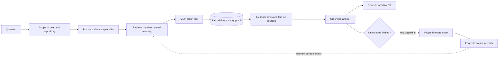

<p align="center">
  
</p>

<h1 align="center">Engram</h1>

<p align="center"><strong>Repository knowledge you can trace, save, and use again.</strong></p>

Engram turns the activity around a GitHub repository into a FalkorDB knowledge graph. Its agents follow connections between contributors, pull requests, reviews, files, commits, issues, and discussions to answer questions with evidence. Signed-in users can save source-backed findings as project memory and retrieve relevant notes in later investigations.

## The problem

The reason behind a code change is rarely in one place. A pull request may touch a file that was reviewed in earlier work, discussed in an issue, and understood by a contributor who has since moved on. Finding that context by browsing GitHub record by record is slow, especially for someone new to the repository.

Engram connects those records as a graph and lets an agent investigate the paths between them. The product is repository-agnostic: a signed-in user selects a repository from their GitHub installation, while visitors can import and explore any public repository without signing in.

## A short product walkthrough

1. **Choose a repository.** Connect GitHub, or enter a public `owner/repo` in the guest explorer.
2. **Build its graph.** Engram imports a bounded, recent activity window and writes typed repository records and relationships to FalkorDB.
3. **Ask an investigation question.** For example, “Who should review PR #442?” The Reviewer Router follows the PR's changed files to earlier PRs and reviews, then ranks contributors by relevant review history.
4. **Inspect the evidence.** Read the source-linked answer, inspect the Cypher query and parameters, and explore the connected graph neighborhood.
5. **Carry a finding forward.** A signed-in user can save an investigation to project memory. Engram links that memory to its source records and can surface it during later, related investigations.

Public guest graphs are isolated by repository. Guest questions are read-only and are not saved as personal memory.

## How the agent works



The LangGraph workflow contains a planner, a saved-memory retrieval step, an MCP tool call, and a grounded answer step. Gemini can select a read-only tool and phrase the graph-derived draft when configured. Deterministic routing and answer templates remain available without a model key. The model does not supply the underlying repository facts.

The five specialist tools are:

| Investigator | FalkorDB tool | Typical question |
|---|---|---|
| Reviewer Router | `reviewer_candidates` | Who has reviewed work on the files in this PR? |
| Expertise Finder | `expertise_lookup` | Who has relevant review history for this topic or path? |
| Decision Trace | `decision_trace` | Which discussions may explain this change? |
| Contributor Activity | `contributor_activity` | Who has recently contributed commits in the indexed window? |
| Project Guide | `repository_search` | Which PRs or issues match this record, topic, or contributor? |

Each investigation is stored as an `Episode` in the signed-in user's repository graph. Saving an answer creates a `ProjectMemory` node connected to that episode and to matching GitHub source nodes with `GROUNDED_IN` edges. Memory is scoped to the authenticated user and selected repository; it is never shared with guest graphs or another user's graph.

## Why FalkorDB is part of the reasoning

Engram needs to follow relationships, not just retrieve isolated text. A reviewer recommendation is based on paths such as:

```text
Pull request ──MODIFIES──> File
File <──MODIFIES── Prior pull request
Prior pull request <──ON_PR── Review <──SUBMITTED── Contributor
```

Parameterized Cypher traversals find the connected records and calculate evidence such as shared files and related reviews. The answer exposes the query, its parameters, source links, and a bounded graph neighborhood so a user can check the result. FalkorDB stores both imported GitHub entities and Engram's episode and project-memory nodes in the same graph.

## Capability map

| User-visible capability | Implementation |
|---|---|
| Connect a GitHub account and select a repository | GitHub App user authorization, installation access, Next.js session boundary |
| Explore a public repository without OAuth | Public GitHub REST import, reserved guest graph, read-only API routes |
| Ask a repository question | Next.js API route, FastAPI agent core, LangGraph workflow |
| Discover investigators and call tools | FastMCP catalog and parameterized, read-only FalkorDB tools |
| Review graph paths and source records | Cypher trace, source links, neighborhood explorer, node detail |
| Remember an investigation across sessions | `Episode` nodes, user-saved `ProjectMemory` nodes, `HAS_MEMORY`, `PRESERVES`, and `GROUNDED_IN` relationships |
| Use natural phrasing when configured | Optional Gemini tool selection and constrained graph-grounded synthesis |

## Architecture

| Layer | Technology | Responsibility |
|---|---|---|
| Web app | Next.js 15 App Router, React 18, TypeScript | Landing/setup flows, repository workspaces, graph explorer, chat and API gateway |
| Authentication boundary | GitHub App OAuth, `jose`, Node.js crypto | Validates OAuth state/PKCE, encrypts the session, scopes repository access |
| Agent core | Python 3.12, FastAPI, LangGraph | Plans each investigation, retrieves saved context, calls graph tools, grounds answers |
| Tool boundary | FastMCP | Exposes the repository investigators through MCP discovery and tool calls |
| Graph store | FalkorDB | Stores typed repository entities, their relationships, episodes, and saved project memory |
| Source data | GitHub REST API | Supplies current public or installation-authorized repository activity |
| Optional model | Gemini API | Selects a read-only tool and phrases an evidence-bounded answer |
| Local/deployment services | Docker Compose, Caddy | Runs the graph and Python core locally; production Compose adds HTTPS reverse proxying |

The browser never connects directly to FalkorDB or the Python core. Next.js validates the user session and selected repository, then calls FastAPI over an internal key-protected service boundary. The core derives the graph name from the verified GitHub user ID and repository.

## Data model

| Graph node | Stored context |
|---|---|
| `Repository` | Full name, URL, default branch, visibility, import time and newest indexed activity |
| `Contributor` | GitHub login and links to observed work, reviews, comments, and commits |
| `WorkItem` | Pull request or issue, state, author, timestamps, labels, assignees, and source URL |
| `Review` / `Comment` | Reviewer or author, state or text, timestamp, and source URL |
| `File` | Path and its links to pull requests and commits |
| `Commit` / `RepositoryBranch` | SHA, message, author, date, branch, and source URL |
| `Episode` | Question, graph-grounded answer, investigator, evidence count, and source metadata |
| `ProjectMemory` | User-saved investigation, timestamp, and graph links to the episode and source records |

Relationships include repository membership, authorship, assignment, review requests, submitted reviews, comments, changed files, commits, branches, and saved knowledge. Engram's explorer shows a bounded neighborhood and lets the user follow connections, rather than drawing every record at once.

## Data freshness and scope

Imports check GitHub when a user requests a sync or refresh. Guest imports use unauthenticated public endpoints; signed-in imports use the selected installation's token. Engram displays the last GitHub check and newest activity found in the indexed data. If GitHub is rate-limited or unavailable, the last successful graph snapshot remains available and the UI reports the refresh failure.

The importer intentionally indexes a bounded recent window: up to 200 recently updated pull requests and issues, selected reviews, comments and changed files, up to 100 contributors, and up to 200 deduplicated commits across recent branches. This is a recent-activity graph, not a complete historical archive or a streaming mirror. Public GitHub rate limits and repository activity determine the data available to an import.

## Security and data boundaries

- GitHub OAuth state and PKCE protect the sign-in callback; the session cookie is `HttpOnly`, `SameSite=Lax`, and `Secure` in production.
- GitHub credentials, installation tokens, the App private key, and the internal service key stay on the server. A cloned repository does not contain the owner's credentials or session.
- Private graph names are derived from the verified GitHub user ID and selected repository. Chat, saved memory, graph exploration, and node detail use that same server-verified scope.
- Guest import accepts public repositories only. Guest graphs use a separate reserved identity, guest chat does not save episodes, and guests cannot save personal project memory.
- The GitHub App requests read access for repository contents, issues, pull requests, and metadata. Engram does not modify GitHub records or send Slack messages.
- Saved memory is an explicit user action. It preserves a graph-derived answer and source links; users can inspect or remove saved items from the repository's Saved memory page.

## Run locally

### Requirements

- Node.js 22 or newer
- Docker with Compose
- GitHub App credentials for signed-in use; public guest exploration does not require them
- Gemini API key is optional

### Configure and start services

```sh
cp .env.example .env.local
openssl rand -hex 32
```

Use the generated value as `SESSION_SECRET`, and create a different random `ENGRAM_INTERNAL_API_KEY`. Configure the GitHub App values in `.env.local`; never commit that file or the downloaded private key. For local development on port `3100`, configure the user callback as `http://localhost:3100/api/github/auth/callback` and the App setup URL as `http://localhost:3100/api/github/callback`.

Start FalkorDB and the agent core:

```sh
docker compose up -d --build falkordb core
```

Install dependencies and run Next.js:

```sh
npm ci
npm run dev
```

Open [http://localhost:3100](http://localhost:3100). Use `/demo` to import a public repository without signing in, or connect GitHub to select a repository and use personal project memory. Optional local service views are available at [FalkorDB Browser](http://localhost:3001) and [FastAPI health](http://localhost:8000/health).

## Verification

```sh
npm run build
npm run test:e2e
```

The browser-level checks cover key setup and OAuth routes, guest access boundaries, saved-memory authorization, cache headers, and service-status redaction.

## Trade-offs

Engram uses deterministic Cypher builders for explainable, bounded graph access. This is easier to audit than unrestricted text-to-Cypher, though it limits the range of questions. Gemini improves tool selection and phrasing but is optional and receives bounded graph-derived context when enabled. Imports are recent snapshots rather than a full archive; a public multi-replica deployment should add a shared rate limiter, background sync queue, and webhook-driven updates before increasing import depth.

Repository activity is read-only; saving project memory is an explicit action within the user's private Engram graph.
