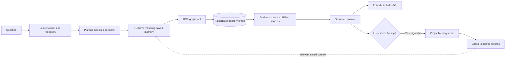

<p align="center">
  
</p>

<h1 align="center">Engram</h1>

<p align="center"><strong>Graph-grounded GitHub investigation and local issue repair.</strong></p>

Engram builds a repository-specific knowledge graph in FalkorDB from GitHub collaboration activity and an index of the source tree. Its agents traverse that graph to explain repository history, find reviewers and relevant contributors, trace discussions, and connect issue reports to code and tests.

For a selected issue, Engram uses graph evidence to choose candidate files, asks a configured model for a bounded patch, applies it on a local issue branch, runs targeted checks, and presents the diff with the graph trace for review. Signed-in users can save useful investigations as repository-scoped memory. Visitors can import public repositories without signing in.

## What Engram helps solve

| Repository problem | Engram workflow |
|---|---|
| Context is split across pull requests, issues, reviews, comments, commits, and files | Ask a repository question and inspect the FalkorDB records, Cypher query, parameters, and GitHub sources behind the answer. |
| Finding an appropriate reviewer or contributor takes manual history searches | The Reviewer Router follows a pull request through its changed files to earlier pull requests and their reviews, then ranks contributors from that recorded overlap. Expertise Finder and Contributor Activity use the same imported history for topic and activity questions. |
| An issue report does not point directly to the relevant code or regression test | The issue investigator combines the issue with FalkorDB code-graph evidence to select source and test files before generating a local patch. |
| A large graph is difficult to inspect all at once | Explore a bounded neighborhood, filter by record type, inspect node details, and follow relationships to load the next neighborhood. |
| Useful investigation context gets lost between questions | Signed-in investigations are stored as Episodes. Users can save selected findings as ProjectMemory and retrieve related notes in later investigations. |

## How a repository moves through Engram

1. **Connect or choose a repository.** Sign in with GitHub and select an installed repository, or enter a public `owner/repo` in the guest explorer.
2. **Import repository context.** Engram fetches a bounded GitHub activity snapshot and stores typed nodes and relationships in a graph scoped to that repository (and, for signed-in users, that user). The source index stores file metadata and selected code relationships in FalkorDB.
3. **Ask or investigate.** Ask questions about reviewers, expertise, decisions, contributors, or repository records; or choose a GitHub issue to investigate with the code graph.
4. **Inspect evidence and changes.** Follow the graph, inspect source links and Cypher, or review the issue repair’s selected files, diff, test output, and graph trace.
5. **Keep useful findings.** Signed-in users can save an investigation to ProjectMemory for later related questions. Guest questions are read-only and are not saved as personal memory.

## Product flows at a glance

### Import a repository


### Ask a graph-grounded question


### Investigate and prepare an issue fix


### Explore and follow graph connections


## Graph-guided issue investigation and local repair

The issue-repair flow is available to signed-in users for repositories explicitly enabled in the local repair configuration.

1. Open **Code graph**, refresh the issue list, and import the selected repository's current default-branch source snapshot.
2. Select an issue and choose **Fix selected issue**. Engram refreshes the issue details and asks the FastAPI graph investigator for related records from the selected user's FalkorDB graph.
3. The repair workflow matches issue terms against indexed file and symbol metadata, then follows stored `TESTS` relationships to identify a related test file. It stops if the graph cannot identify both source and test candidates.
4. A configured model receives the issue, graph evidence, and bounded snippets from graph-selected files. The patch is restricted to those paths, must include a change to a selected test file, and is limited to six files.
5. Engram fetches the current base branch, creates an `engram/issue-*` branch in the configured checkout, applies the patch, and runs the linked Python `pytest` checks. Existing checkout changes are kept in a recoverable stash. The branch is committed only when checks pass; a failed repair is discarded and the original branch restored.

The review page shows the issue, proposed summary, branch and base commit, changed files, diff, test output, and FalkorDB trace. The current repair flow ends with a local branch and review page.

Configure `ENGRAM_REPAIR_ROOT` and, if Engram should use an existing checkout, map `owner/repo` to its path in `ENGRAM_REPAIR_CHECKOUTS`. Otherwise it creates a local clone under the repair root. After a repair, `git branch --show-current` in that checkout shows the issue branch. Any stash created to preserve pre-existing work is retained for recovery.


## Reviewer intelligence: find a reviewer from graph evidence

Start with a public repository and one of its pull requests. Ask, “Who should review this change?” The Reviewer Router reads the pull request’s changed files, follows those files to earlier pull requests, then follows submitted reviews to the contributors who reviewed that work. It ranks candidates from those observed connections and returns the supporting repository records with GitHub links.

The graph explorer makes that reasoning inspectable. **All** shows the connected neighborhood; PRs, Issues, Reviews, Reviewers, Assignees, Commits, Comments, Files, Contributors, and Labels narrow it to matching graph records or relationships. Select a node to inspect its properties and direct links, then follow it to load a new neighborhood. The same paths can be inspected through the Cypher query and parameters shown with an answer.

In the explorer, **Reviews** and **Reviewers** filters make it easier to inspect the connections among changed files, earlier pull requests, and review activity. Those same paths appear in the Cypher trace attached to an answer.

## How the agent works



The LangGraph workflow routes the question, retrieves matching saved memory, calls one graph tool through MCP, and grounds the response in the returned records. A configured Gemini key can select the specialist tool; a workspace or user-selected provider can phrase the graph-derived answer. Without a model, deterministic routing and answer templates are used. Graph records and GitHub sources provide the repository evidence.

The five specialist tools are:

| Investigator | FalkorDB tool | Typical question |
|---|---|---|
| Reviewer Router | `reviewer_candidates` | Who has reviewed work on the files in this PR? |
| Expertise Finder | `expertise_lookup` | Who has relevant review history for this topic or path? |
| Decision Trace | `decision_trace` | Which discussions may explain this change? |
| Contributor Activity | `contributor_activity` | Who has recently contributed commits in the indexed window? |
| Project Guide | `repository_search` | Which PRs or issues match this record, topic, or contributor? |

Each investigation is stored as an `Episode` in the signed-in user's repository graph. Saving an answer creates a `ProjectMemory` node connected to that episode and to matching GitHub source nodes with `GROUNDED_IN` edges. Memory is scoped to the authenticated user and selected repository; it is never shared with guest graphs or another user's graph.

## Why FalkorDB is part of the reasoning

Engram needs to follow relationships, not just retrieve isolated text. A reviewer recommendation is based on paths such as:

```text
Pull request ──MODIFIES──> File
File <──MODIFIES── Prior pull request
Prior pull request <──ON_PR── Review <──SUBMITTED── Contributor
```

Parameterized Cypher traversals find the connected records and calculate evidence such as shared files and related reviews. The answer exposes the query, its parameters, source links, and a bounded graph neighborhood so a user can check the result. FalkorDB stores both imported GitHub entities and Engram's episode and project-memory nodes in the same graph.

### What Engram stores and traverses

The diagram shows representative graph paths written by the GitHub importer, source indexer, and agent workflow; it is not an exhaustive schema. Reviewer investigations follow pull requests, files, reviews, and contributors. Issue repair uses `CodeFile`, `CodeSymbol`, and `TestFile` records. Code-structure edges use `CODE_RELATION` with `IMPORTS`, `DEFINES`, or `TESTS` in the `kind` property.


The source index catalogs `.py`, `.js`, `.jsx`, `.ts`, `.tsx`, `.go`, `.rs`, `.java`, and `.rb` files. It parses Python ASTs for class/function symbols and imports; other supported files receive file metadata but not language-specific symbol graphs. Test relationships are inferred from repository paths and matching file stems. Source bodies are read from the selected base during repair only for files chosen using FalkorDB evidence.


## Capability map

| User-visible capability | Implementation |
|---|---|
| Connect a GitHub account and select a repository | GitHub App user authorization, installation access, Next.js session boundary |
| Explore a public repository without OAuth | Public GitHub REST import, reserved guest graph, read-only API routes |
| Ask a repository question | Next.js API route, FastAPI agent core, LangGraph workflow |
| Discover investigators and call tools | FastMCP catalog and parameterized, read-only FalkorDB tools |
| Review graph paths and source records | Cypher trace, source links, neighborhood explorer, node detail |
| Filter and follow graph connections | FalkorDB-backed All, PR, issue, review, reviewer, assignee, commit, comment, file, contributor, and label views |
| Remember an investigation across sessions | `Episode` nodes, user-saved `ProjectMemory` nodes, `HAS_MEMORY`, `PRESERVES`, and `GROUNDED_IN` relationships |
| Import source structure for issue repair | The index stores file metadata for supported source suffixes; Python AST parsing extracts symbols and imports, and matching file stems infer `TESTS` edges. Repair reads source from the selected base only for graph-selected files and currently requires linked Python `pytest` tests |
| Prepare a local issue repair | Graph-linked investigator, bounded model patch generation, active issue branch in the configured checkout, focused checks, local commit, diff review, and a separate graph trace page |
| Phrase graph-grounded answers | Optional configured model synthesis; deterministic answer templates remain available without a model |

## Architecture

| Layer | Technology | Responsibility |
|---|---|---|
| Web app | Next.js 15 App Router, React 18, TypeScript | Landing/setup flows, repository workspaces, graph explorer, chat and API gateway |
| Authentication boundary | GitHub App OAuth, `jose`, Node.js crypto | Validates OAuth state/PKCE, encrypts the session, scopes repository access |
| Agent core | Python 3.12, FastAPI, LangGraph | Plans each investigation, retrieves saved context, calls graph tools, grounds answers |
| Tool boundary | FastMCP | Exposes the repository investigators through MCP discovery and tool calls |
| Graph store | FalkorDB | Stores typed repository entities, their relationships, episodes, and saved project memory |
| Source data | GitHub REST API | Supplies current public or installation-authorized repository activity |
| Optional model | Gemini, OpenAI, Anthropic, Groq, OpenRouter, Together, DeepSeek, or Ollama | Phrases graph-grounded answers and proposes issue patches; Gemini can select the graph tool when configured. Deterministic routing remains available. |
| Local/deployment services | Docker Compose, Caddy | Runs the graph and Python core locally; production Compose adds HTTPS reverse proxying |

The browser never connects directly to FalkorDB or the Python core. Next.js validates the user session and selected repository, then calls FastAPI over an internal key-protected service boundary. The core derives the graph name from the verified GitHub user ID and repository.

## Data model

| Graph node | Stored context |
|---|---|
| `Repository` | Full name, URL, default branch, visibility, import time and newest indexed activity |
| `Contributor` | GitHub login and links to observed work, reviews, comments, and commits |
| `WorkItem` | Pull request or issue, state, author, timestamps, labels, assignees, and source URL |
| `Review` / `Comment` | Reviewer or author, state or text, timestamp, and source URL |
| `File` | Path and its links to pull requests and commits |
| `Commit` / `RepositoryBranch` | SHA, message, author, date, branch, and source URL |
| `RepositoryLabel` | Label name attached to indexed pull requests or issues |
| `CodeFile` / `TestFile` | Repository-relative path, language, file size, hash, summary, and test/source classification |
| `CodeSymbol` | A parsed Python class or function name and its defining file |
| `CodebaseSnapshot` | Imported source revision, branch, timestamp, and node/relationship counts |
| `Agent` | Specialist agent that produced an investigation episode |
| `Episode` | Question, graph-grounded answer, investigator, evidence count, and source metadata |
| `ProjectMemory` | User-saved investigation, timestamp, and graph links to the episode and source records |

Relationships include `HAS_ITEM`, `HAS_CONTRIBUTOR`, `OPENED`, `ASSIGNED`, `REVIEW_REQUESTED`, `MODIFIES`, `SUBMITTED`, `ON_PR`, `WROTE`, `ON_ITEM`, `HAS_COMMIT`, `AUTHORED`, `HAS_BRANCH`, `ON_BRANCH`, `CLOSES`, and `HAS_LABEL`. Agent memory uses `HAS_MEMORY`, `PRESERVES`, and `GROUNDED_IN`; agent coordination records `HANDED_OFF_TO`. Source-code links are stored as `CODE_RELATION` edges with `IMPORTS`, `DEFINES`, or `TESTS` in the `kind` property. Engram's explorer shows a bounded neighborhood and lets the user follow connections, rather than drawing every record at once.

## Data freshness and scope

Signed-in imports check GitHub when a user requests a sync or refresh; guest imports use unauthenticated public endpoints. Engram displays the last GitHub check and newest activity found in the indexed data. A failed refresh does not delete the last successful graph snapshot; the refresh request reports the GitHub error.

Signed-in imports index up to 200 recently updated pull requests and 200 issues. Detailed reviews, comments, and changed files are fetched for the 50 most recently updated pull requests; comments are fetched for the 50 most recently updated issues. The importer also reads up to 100 contributors and branch records, then indexes up to 200 deduplicated commits from the default branch and up to 12 recently active branches.

Guest imports use a smaller public-API window: up to 30 pull requests, one page of the issues endpoint (pull-request rows are filtered out), 40 commits, and 30 branches. Reviews, files, and comments are fetched for up to five pull requests and comments for up to three issues. Public graph snapshots are reused for five minutes before another GitHub fetch is attempted. Both modes create recent snapshots rather than a complete historical archive or a streaming mirror. GitHub rate limits and repository activity affect what an import can retrieve.

## Security and data boundaries

- GitHub OAuth state and PKCE protect the sign-in callback; the session cookie is `HttpOnly`, `SameSite=Lax`, and `Secure` in production.
- GitHub access tokens are held in an encrypted, `HttpOnly` session cookie. The GitHub App private key and internal service key stay server-side; a cloned repository does not contain the owner's credentials.
- Private graph names are derived from the verified GitHub user ID and selected repository. Chat, saved memory, graph exploration, and node detail use that same server-verified scope.
- Guest import accepts public repositories only. Guest graphs use a separate reserved identity, guest chat does not save episodes, and guests cannot save personal project memory.
- The GitHub App requests read access for repository contents, issues, pull requests, and metadata. The issue repair process operates on the configured local checkout.
- Saved memory is an explicit user action. It preserves a graph-derived answer and source links; users can inspect or remove saved items from the repository's Saved memory page.
- A user-supplied model key is held in browser `sessionStorage` and sent with chat or repair requests. It is not stored in FalkorDB.

## Run locally

### Requirements

- Node.js 22 or newer
- Docker with Compose
- Python 3.12 (only needed when running backend unit tests outside Docker)
- GitHub App credentials for signed-in use; public guest exploration does not require them
- A model API key is optional; deterministic graph answers work without one, and Ollama can run locally

### Configure and start services

```sh
cp .env.example .env.local
openssl rand -hex 32
```

Use the generated value as `SESSION_SECRET`, and create a different random `ENGRAM_INTERNAL_API_KEY`. Configure the GitHub App values in `.env.local`; never commit that file or the downloaded private key. For local development on port `3100`, configure the user callback as `http://localhost:3100/api/github/auth/callback` and the App setup URL as `http://localhost:3100/api/github/callback`.

For local issue repair, set `ENGRAM_REPAIR_CHECKOUTS` to a JSON object mapping an exact `owner/repo` name to a local checkout, for example `{"your-org/your-repo":"/absolute/path/to/checkout"}`. If no checkout is mapped, Engram clones the selected repository beneath `ENGRAM_REPAIR_ROOT/checkouts/`. Keep `ENGRAM_REPAIR_ROOT` outside the source checkout; it stores private run manifests, patches, and clones. Repair and test execution are disabled unless the exact repository is listed in `ENGRAM_REPAIR_ALLOWED_REPOSITORIES` and `ENGRAM_ALLOW_UNSANDBOXED_REPAIR_TESTS=true` is explicitly set. This feature executes repository test code on the local host and is intended only for trusted checkouts; it is not a sandbox for arbitrary public repositories. Engram changes branches only after a model has produced a validated patch. Existing checkout edits are stashed with `--include-untracked` and retained for recovery.

Start FalkorDB and the agent core:

```sh
docker compose up -d --build falkordb core
```

Install dependencies and run Next.js:

```sh
npm ci
npm run dev
```

Open [http://localhost:3100](http://localhost:3100). Use `/demo` to import a public repository without signing in, or connect GitHub to select a repository and use personal project memory. Optional local service views are available at [FalkorDB Browser](http://localhost:3002) and [FastAPI health](http://localhost:8000/health).

## Verification

From the repository root, run the web build and application route checks:

```sh
npm run build
npm run test:e2e
```

With the app and configured services running at `http://localhost:3100`, the Node integration suite exercises GitHub setup and status routes, guest access boundaries, saved-memory authorization, cache headers, and service-status redaction. To run the Python unit tests, install `backend/requirements.txt` and run:

```sh
python3 -m pip install -r backend/requirements.txt
PYTHONPATH=backend python3 -m unittest discover -s backend/tests
```

## Trade-offs

Engram uses deterministic Cypher builders for explainable, bounded graph access. This is easier to audit than unrestricted text-to-Cypher, though it limits the range of questions. A configured model can phrase graph-grounded answers; Gemini can also select a specialist tool. Model use is optional for repository questions, which fall back to deterministic routing and templates. Issue repair requires a configured provider. The current targeted test runner uses graph-linked Python `pytest` files. Imports are recent snapshots rather than a full archive; a public multi-replica deployment should add a shared rate limiter, background sync queue, and webhook-driven updates before increasing import depth.

Repository activity is read-only; saving project memory is an explicit action within the user's private Engram graph.

Code repair is a separate opt-in action. The selected issue, graph evidence, and a bounded set of graph-selected source and test snippets are sent to the configured model provider. Engram validates the returned diff and targeted tests before it keeps a local branch and commit in the configured checkout; existing local changes are preserved in a recoverable stash.
